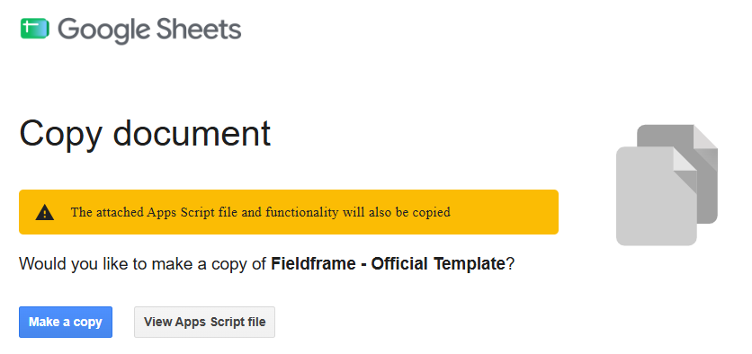
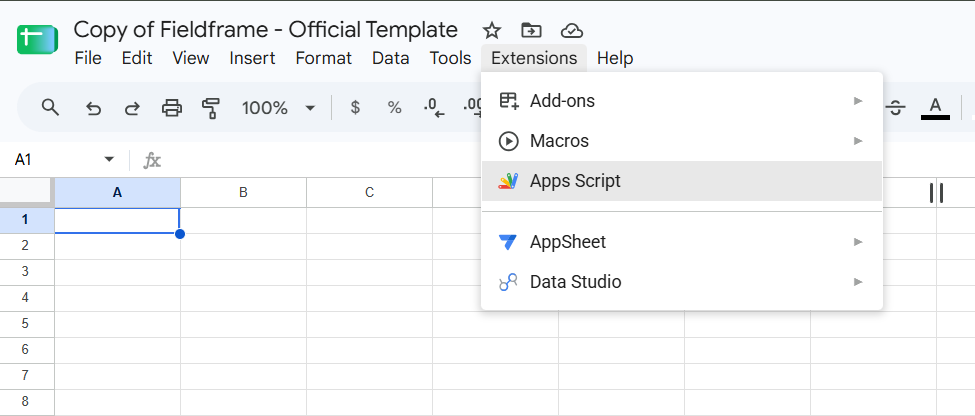
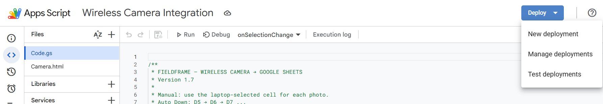
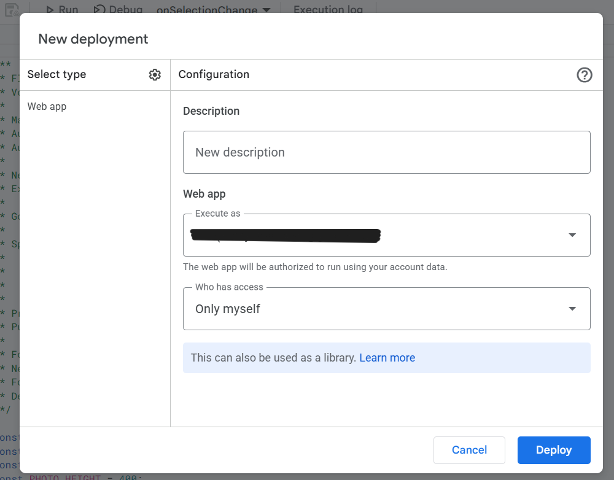
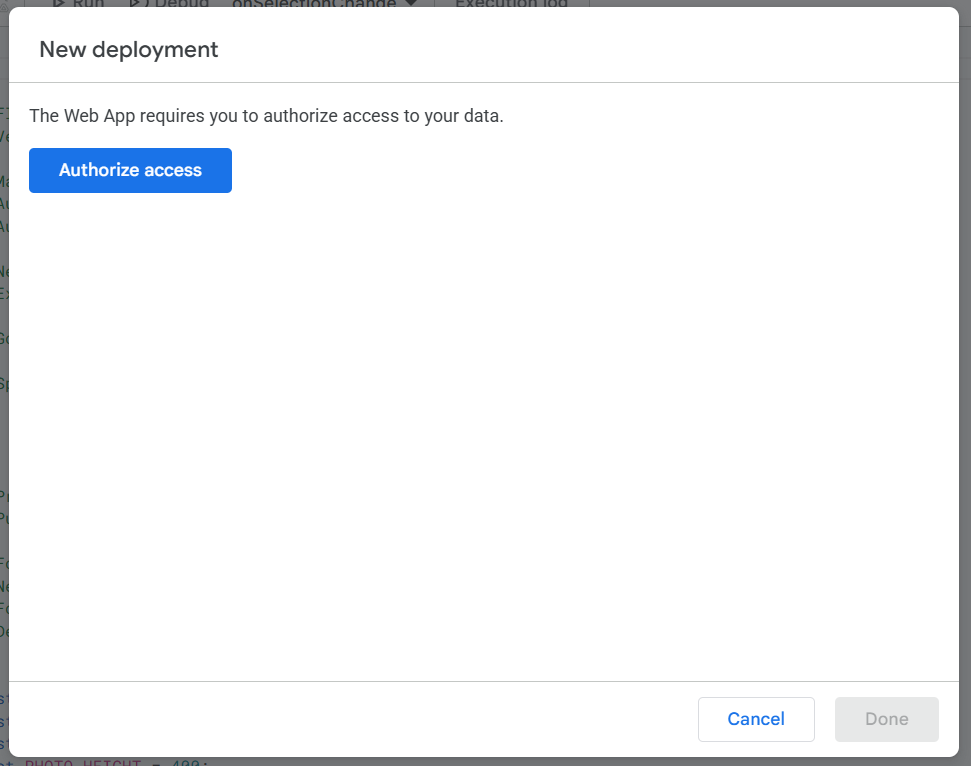
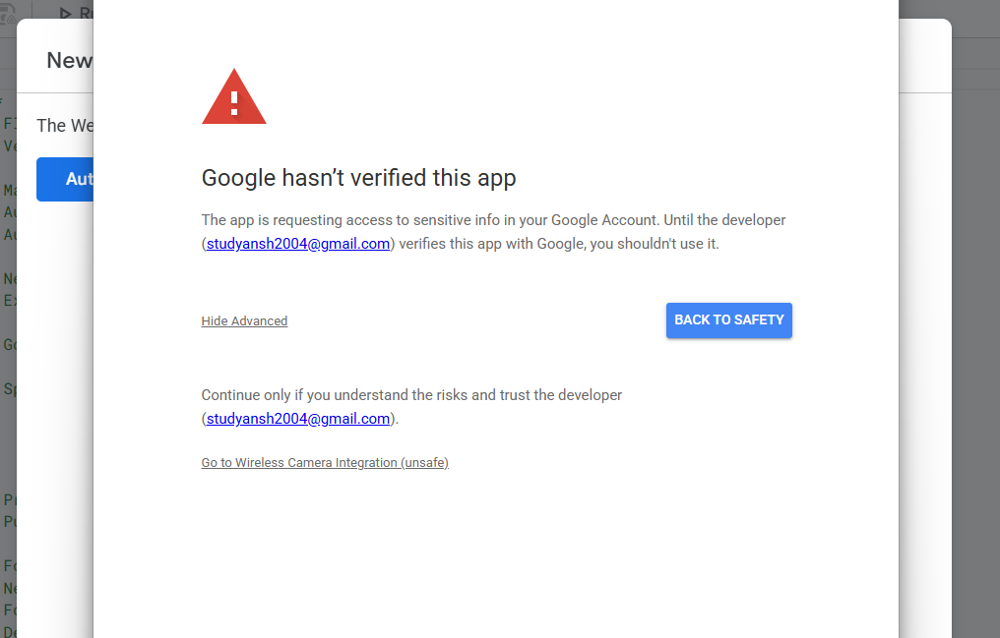
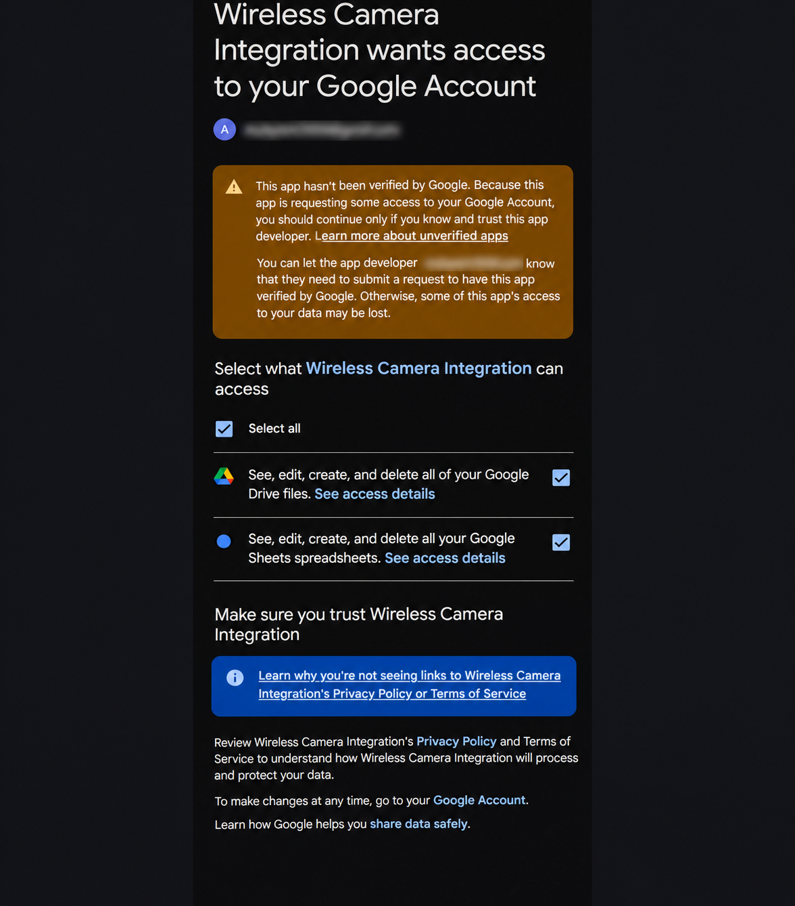
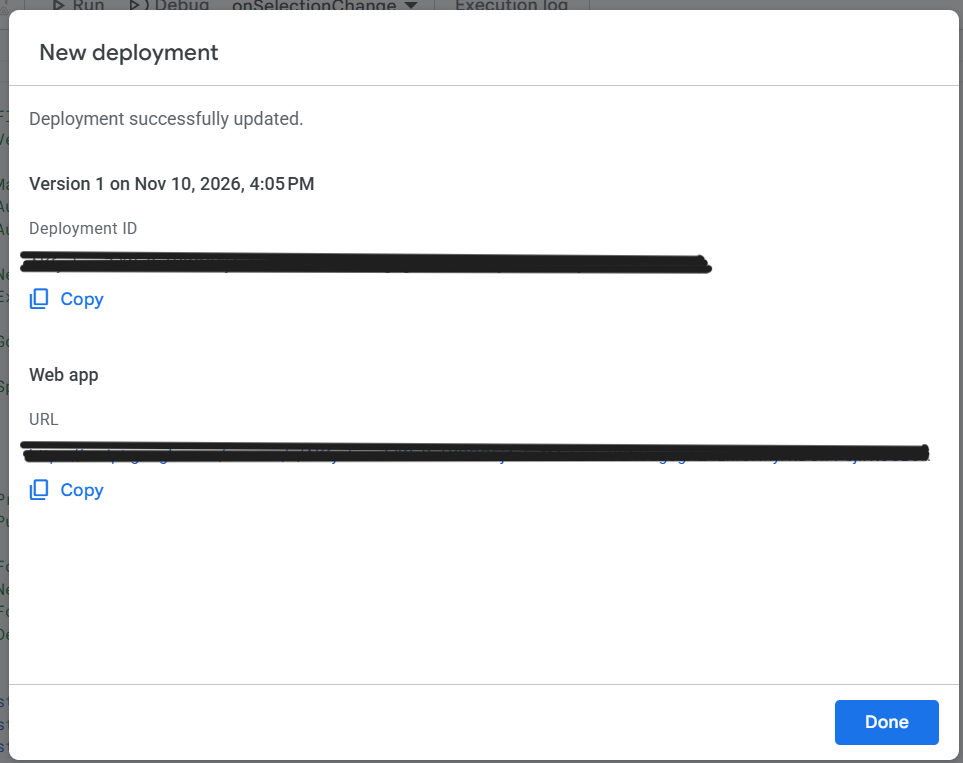
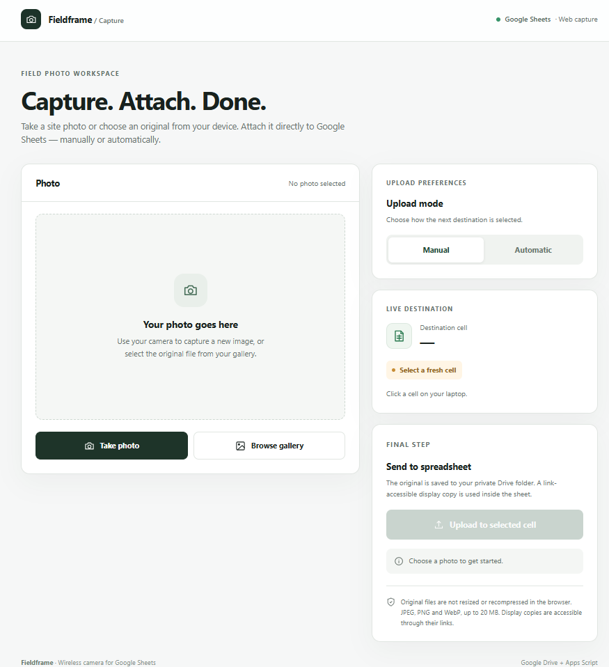

<p align="center">
  <strong>Choose your language / अपनी भाषा चुनें</strong>
</p>

<p align="center">
  <a href="README.md">English</a>
  &nbsp; | &nbsp;
  <a href="README.hi.md">हिन्दी</a>
</p>

---

# Fieldframe

**Google Sheets के लिए मोबाइल से सीधे फोटो अपलोड करने का आसान तरीका।**

Fieldframe एक मुफ़्त, ओपन-सोर्स एप्लिकेशन है, जिसे Google Apps Script से बनाया गया है। इसकी मदद से आप अपने मोबाइल से फोटो खींचकर या गैलरी से फोटो चुनकर उसे सीधे Google Sheets के चुने हुए सेल में डाल सकते हैं।

यह खासकर साइट निरीक्षण, निर्माण कार्य, प्रॉपर्टी सर्वे, डिजाइनिंग और ऐसे दूसरे कामों में उपयोगी है, जहाँ फोटो के साथ Google Sheets में रिकॉर्ड रखना पड़ता है।

Fieldframe, Google Sheets, Google Drive और Google Apps Script के माध्यम से काम करता है। इसके लिए आपको कोई अलग सर्वर या वेबसाइट होस्ट करने की जरूरत नहीं है।

## मुख्य सुविधाएँ

| सुविधा | इसका काम |
|---|---|
| मोबाइल से फोटो अपलोड | मोबाइल के ब्राउज़र से फोटो खींचें या चुनें और अपलोड करें। |
| Automatic Cell Detection | Google Sheets में चुने गए सेल को अपने आप पहचानता है। |
| Manual Mode | हर फोटो के लिए Google Sheets में सेल चुन सकते हैं। |
| Auto Down | अगली फोटो के लिए नीचे की ओर अगला खाली सेल चुनता है। |
| Auto Right | अगली फोटो के लिए दाईं ओर अगला खाली सेल चुनता है। |
| सेल की सुरक्षा | पहले से भरे हुए सेल का डेटा ओवरराइट होने से बचाता है। |
| Original Photo Storage | असली फोटो Google Drive में सुरक्षित रखता है। |
| In-cell Images | फोटो को सीधे Google Sheets के सेल के अंदर दिखाता है। |
| Multiple Worksheets | एक ही Google Sheets फ़ाइल के अलग-अलग टैब में काम कर सकते हैं। |
| Automatic Folder Management | फोटो के लिए Google Drive में अपने आप फोल्डर बनाता है। |
| Folder Recovery | जरूरत पड़ने पर हटे हुए स्टोरेज फोल्डर दोबारा बना सकता है। |

---

## Fieldframe कैसे सेटअप करें?

नीचे दिए गए स्टेप्स को क्रम से पूरा करें। इसके लिए प्रोग्रामिंग या कोडिंग आना जरूरी नहीं है।

### Step 1 — अपनी Fieldframe Google Sheet बनाएँ

सबसे पहले नीचे दिए गए लिंक पर क्लिक करें:

**[Fieldframe Google Sheet की कॉपी बनाएँ](https://docs.google.com/spreadsheets/d/1bvV0MiGuvt216H870_CBKpRIjtGjZq5Z694eKtbWcMQ/copy)**

जरूरत पड़ने पर अपने Google Account से लॉगिन करें।

आपके सामने Google का **Copy document** पेज खुलेगा।



यहाँ **Make a copy** पर क्लिक करें।

अब आपके Google Drive में Fieldframe की अपनी Google Sheets फ़ाइल बन जाएगी।

इस कॉपी में जरूरी Apps Script फाइलें `Code.gs` और `Camera.html` पहले से मौजूद हैं। आपको अलग से कोई कोड कॉपी-पेस्ट करने की जरूरत नहीं है।

आप अपनी जरूरत के अनुसार Google Sheet का नाम बदल सकते हैं।

### Step 2 — Google Apps Script खोलें

अपनी बनाई हुई Google Sheet खोलें।

ऊपर मेन्यू में **Extensions** पर क्लिक करें।



अब **Apps Script** पर क्लिक करें।

Google Apps Script का एडिटर नए ब्राउज़र टैब में खुल जाएगा।

यहाँ Fieldframe का कोड पहले से मौजूद होगा। आपको कोई नया कोड डालने की जरूरत नहीं है।

### Step 3 — नया Deployment बनाएँ

Apps Script एडिटर में ऊपर दाईं ओर **Deploy** बटन ढूँढें।

उस पर क्लिक करें और फिर **New deployment** चुनें।



अब एक नई विंडो खुलेगी जिसमें हमें Fieldframe को Web App के रूप में सेटअप करना है।

### Step 4 — Web App की सेटिंग करें

**New deployment** विंडो में:

1. **Select type** के नीचे बने **Settings (gear icon)** पर क्लिक करें।
2. **Web app** चुनें।
3. अब Web App की सेटिंग दिखाई देगी।
4. नीचे दी गई सेटिंग भरें।

| Setting | क्या चुनना है |
|---|---|
| Description | Fieldframe v1.7 |
| Execute as | Me |
| Who has access | Only myself |



**इन सेटिंग्स का मतलब:**

- **Execute as — Me:** Fieldframe आपके अधिकृत Google Account से Google Sheets और Google Drive का इस्तेमाल करेगा।
- **Who has access — Only myself:** केवल आपका Google Account इस Web App को खोल सकेगा। व्यक्तिगत इस्तेमाल के लिए यही सेटिंग सुझाई गई है।

सभी सेटिंग सही होने के बाद **Deploy** पर क्लिक करें।

### Step 5 — Fieldframe को Google की अनुमति दें

Deploy करने के बाद Google आपसे कुछ अनुमतियाँ माँगेगा।

यह स्क्रीन दिखाई दे सकती है:



**Authorize access** पर क्लिक करें।

अब Google Account चुनने की विंडो खुलेगी।

वही Google Account चुनें जिससे आपने Fieldframe की Google Sheet बनाई है।

Fieldframe को Google Sheets और Google Drive की अनुमति इसलिए चाहिए ताकि वह फोटो अपलोड कर सके, फोल्डर बना सके और फोटो को सही सेल में दिखा सके।

अनुमति देने से पहले उसे ध्यान से पढ़ें।

कभी-कभी Google एक चेतावनी भी दिखा सकता है कि यह ऐप सत्यापित नहीं है।

ऐसी स्थिति में अगला स्टेप पढ़ें।

### Step 6 — Google की Verification Warning समझें

पहली बार Fieldframe Deploy करते समय Google यह संदेश दिखा सकता है:

**"Google hasn't verified this app"**

ऐसा इसलिए हो सकता है क्योंकि आप अपनी कॉपी से Google Apps Script ऐप Deploy कर रहे हैं।



अगर यह चेतावनी दिखाई दे:

1. **Advanced** पर क्लिक करें।
2. सुनिश्चित करें कि यह वही Apps Script प्रोजेक्ट है जिसकी आपने कॉपी बनाई है।
3. Google की चेतावनी और जोखिम ध्यान से पढ़ें।
4. यदि आपने कोड की जाँच कर ली है और आप इस ऐप पर भरोसा करते हैं, तभी **Go to Wireless Camera Integration (unsafe)** पर क्लिक करें।

अगर आपने Apps Script प्रोजेक्ट का नाम बदला है, तो यहाँ नाम अलग दिखाई दे सकता है।

**जरूरी:** अगर आप ऐप या उसकी माँगी गई अनुमतियों को लेकर आश्वस्त नहीं हैं, तो आगे न बढ़ें। **Back to Safety** चुनें।

### Step 7 — Google Account की Permissions दें

अब Google आपको Fieldframe द्वारा माँगी जा रही अनुमतियाँ दिखाएगा।



यहाँ:

1. Google Drive और Google Sheets की माँगी गई अनुमतियाँ ध्यान से पढ़ें।
2. दोनों अनुमतियाँ देने का निर्णय लेने के बाद **Select all** पर क्लिक करें।
3. नीचे तक स्क्रॉल करें।
4. **Continue** पर क्लिक करें।

**महत्वपूर्ण चेतावनी:** इन अनुमतियों से ऐप को आपके Google Drive और Google Sheets की फाइलें देखने, बदलने, बनाने या हटाने जैसी व्यापक पहुँच मिल सकती है।

इन्हें केवल तभी स्वीकार करें जब आपने ऐप का सोर्स कोड और अनुमति संबंधी जोखिम समझ लिए हों।

इसके बाद Google Apps Script Deployment पूरा करेगा।

### Step 8 — अपना Fieldframe Web App URL कॉपी करें

सफल Deployment के बाद एक confirmation विंडो दिखाई देगी।



अब:

1. **Web app** वाला भाग ढूँढें।
2. **URL** के सामने **Copy** बटन पर क्लिक करें।
3. इस लिंक को सेव कर लें या अपने मोबाइल पर भेज दें।
4. **Done** पर क्लिक करें।

**ध्यान दें:** आपको **Web app URL** कॉपी करना है, **Deployment ID** नहीं।

यही लिंक आपके मोबाइल पर Fieldframe का कैमरा इंटरफेस खोलेगा।

क्योंकि आपने **Who has access — Only myself** चुना है, इसलिए मोबाइल पर भी उसी Google Account से लॉगिन रहना जरूरी है।

### Step 9 — मोबाइल पर Fieldframe खोलें

अपने मोबाइल के ब्राउज़र में कॉपी किया हुआ Web App URL खोलें।

जरूरत पड़ने पर उसी Google Account से लॉगिन करें जिससे आपने ऐप Deploy किया था।

आपके सामने Fieldframe का इंटरफेस दिखाई देगा।



इसमें मुख्य रूप से चार भाग हैं:

1. **Photo:** कैमरे से नई फोटो लें या गैलरी से फोटो चुनें।
2. **Upload Mode:** Manual या Automatic Mode चुनें।
3. **Live Destination:** Google Sheets में चुना गया सेल यहाँ दिखाई देता है।
4. **Send to Spreadsheet:** चुनी गई फोटो को उस सेल में अपलोड करता है।

अपने कंप्यूटर पर Google Sheet और मोबाइल पर Fieldframe दोनों खोलकर रखें।

अब आप अपनी पहली फोटो अपलोड कर सकते हैं।

### Step 10 — वीडियो देखकर समझें

नीचे दिए गए वीडियो में Fieldframe का पूरा इस्तेमाल दिखाया गया है।

इसमें आप देख सकते हैं कि मोबाइल से फोटो कैसे चुनते हैं, Google Sheets में सेल कैसे पहचानता है और फोटो सीधे उसी सेल में कैसे पहुँचती है।

[](https://youtu.be/cqA6P_2qDD8)

**[Fieldframe का पूरा डेमो YouTube पर देखें](https://youtu.be/cqA6P_2qDD8)**

#### पहली फोटो कैसे अपलोड करें?

1. कंप्यूटर पर अपनी Fieldframe Google Sheet खोलें।
2. जिस खाली सेल में फोटो डालनी है, उस पर क्लिक करें।
3. मोबाइल पर Fieldframe Web App खोलकर रखें।
4. **Live Destination** में सही सेल दिखाई देने का इंतजार करें।
5. नई फोटो लेने के लिए **Take photo** या गैलरी से चुनने के लिए **Browse gallery** पर क्लिक करें।
6. फोटो और उसका destination cell जाँच लें।
7. **Upload to selected cell** पर क्लिक करें।
8. अपलोड पूरा होने का इंतजार करें और Google Sheets में फोटो दिखाई देने की पुष्टि करें।

#### Upload Modes समझें

| Mode | इसका काम |
|---|---|
| Manual | हर फोटो के लिए Google Sheets में चुने गए सेल का इस्तेमाल करता है। |
| Auto Down | पिछली फोटो के नीचे अगला खाली सेल चुनता है। |
| Auto Right | पिछली फोटो के दाईं ओर अगला खाली सेल चुनता है। |

Automatic Mode पहले से भरे हुए सेल को छोड़कर आगे बढ़ता है।

आप Google Sheets में दूसरा सेल चुनकर destination बदल सकते हैं।

अगली फोटो के लिए यही प्रक्रिया दोहराएँ।

---

## इस्तेमाल करते समय जरूरी बातें

### 1. शुरू होने के लिए थोड़ा समय दें

जब आप Google Sheet या Fieldframe Web App को पहली बार खोलते हैं या कुछ समय बाद दोबारा खोलते हैं, तो सेल पहचानने की सुविधा को शुरू होने में थोड़ा समय लग सकता है।

बेहतर परिणाम के लिए:

1. कंप्यूटर पर Google Sheet खोलें।
2. खासकर काफी समय बाद खोलने पर लगभग **1–2 मिनट** का समय देना उपयोगी हो सकता है।
3. मोबाइल पर Fieldframe खोलें या Refresh करें।
4. Google Sheets में कोई खाली सेल चुनें।
5. **Live Destination** में सही सेल दिखाई देने के बाद ही फोटो अपलोड करें।

**ध्यान दें:** 1–2 मिनट इंतजार करना केवल एक सावधानी है। यह कोई निश्चित तकनीकी समय नहीं है। ऐप इससे जल्दी भी तैयार हो सकता है।

अगर सेल दिखाई नहीं देता, तो Google Sheets Refresh करके दोबारा सेल चुनें।

### 2. बहुत तेजी से सेल न बदलें

Fieldframe आपके कंप्यूटर पर चुने गए सेल की जानकारी मोबाइल तक पहुँचाता है।

अगर आप बहुत तेजी से अलग-अलग सेल या Worksheet बदलते हैं, तो कुछ समय के लिए पुराना सेल दिखाई दे सकता है।

इसलिए:

1. सही सेल चुनें।
2. कुछ सेकंड इंतजार करें।
3. **Live Destination** में सही सेल की पुष्टि करें।
4. उसके बाद ही फोटो अपलोड करें।

गलत सेल में फोटो जाने से बचने के लिए यह जाँच जरूरी है।

### 3. दोनों डिवाइस पर ऐप खुला रखें

अच्छे अनुभव के लिए:

- कंप्यूटर पर Google Sheets खोलकर रखें।
- मोबाइल पर Fieldframe Web App खोलकर रखें।
- दोनों डिवाइस पर इंटरनेट चालू रखें।
- फोटो अपलोड करने से पहले सही destination cell की पुष्टि करें।

अगर Web App Refresh या दोबारा खोला गया है, तो उसे कनेक्ट होने और सही सेल दिखाने का समय दें।

---

## Google Drive में फोटो कैसे सेव होती हैं?

Fieldframe अपलोड की गई फोटो के लिए Google Drive में अपने आप फोल्डर बनाता है।

फोल्डर का नाम आपकी Google Sheets फ़ाइल और उसके अलग-अलग Worksheet टैब के अनुसार रखा जाता है।

### Spreadsheet और Worksheet में अंतर

**Spreadsheet:** पूरी Google Sheets फ़ाइल को कहते हैं।

**Worksheet:** उसी फ़ाइल के अंदर मौजूद किसी एक टैब को कहते हैं।

उदाहरण के लिए, आपकी Spreadsheet का नाम है:

`Construction Site Inspection`

इसके अंदर तीन Worksheet हो सकती हैं:

- Building A
- Building B
- Building C

Fieldframe इन सभी Worksheet में उसी Deployment से काम कर सकता है।

### फोल्डर अपने आप कैसे बनते हैं?

जब आप किसी Worksheet में पहली फोटो अपलोड करते हैं, तो Fieldframe उस Worksheet के लिए Google Drive में फोल्डर बना देता है।

उदाहरण:

```text
My Drive/
└── Construction Site Inspection/
    ├── Building A/
    │   ├── Building A-private/
    │   └── Building A-public/
    │
    ├── Building B/
    │   ├── Building B-private/
    │   └── Building B-public/
    │
    └── Building C/
        ├── Building C-private/
        └── Building C-public/
```

हर Worksheet के लिए दो अलग फोटो फोल्डर बनते हैं।

#### Private Folder

`-private` फोल्डर में आपकी अपलोड की गई असली फोटो सेव होती हैं।

इनमें मूल फोटो के डेटा को ब्राउज़र द्वारा छोटा या दोबारा कंप्रेस नहीं किया जाता।

ये फोटो सामान्यतः Private रहती हैं, लेकिन आपके Google Drive की Sharing Settings या बाद में किए गए बदलाव इनकी पहुँच को प्रभावित कर सकते हैं।

#### Public Folder

`-public` फोल्डर में फोटो की अलग Display Copy रखी जाती है।

इस कॉपी का इस्तेमाल Google Sheets के सेल के अंदर फोटो दिखाने के लिए होता है।

**महत्वपूर्ण:** इन Display Copy फाइलों पर Link-based Viewing Permission होती है। जिस व्यक्ति के पास किसी Display Copy का सही लिंक है, वह उस फोटो को देख सकता है।

`-public` नाम का मतलब यह नहीं है कि पूरा फोल्डर अपने आप सार्वजनिक हो गया है।

### फोल्डर कब बनते हैं?

फोल्डर तभी बनता है जब आप उस Worksheet में पहली फोटो अपलोड करते हैं।

उदाहरण:

1. `Building A` नाम की Worksheet बनाएँ।
2. उसमें एक खाली सेल चुनें।
3. फोटो अपलोड करें।
4. Fieldframe, `Building A` के लिए Private और Public फोल्डर बना देगा।
5. अब `Building B` नाम की नई Worksheet बनाएँ।
6. उसमें पहली फोटो अपलोड करें।
7. Fieldframe उसके लिए अलग फोल्डर बना देगा।

आपको Google Drive में ये फोल्डर खुद बनाने की जरूरत नहीं है।

### एक Spreadsheet में कई Worksheet कैसे बनाएँ?

आप एक ही Google Sheets फ़ाइल में कई टैब बना सकते हैं।

1. अपनी Fieldframe Google Sheet खोलें।
2. नीचे **+ (Add sheet)** पर क्लिक करें।
3. नई Worksheet का नाम रखें।
4. उसमें कोई खाली सेल चुनें।
5. Fieldframe में सही Worksheet और सेल दिखाई देने का इंतजार करें।
6. फोटो अपलोड करें।

पहली फोटो अपलोड होते ही उस Worksheet के लिए फोल्डर बन जाएगा।

**एक ही Spreadsheet में नई Worksheet जोड़ने के लिए दोबारा Deployment करने की जरूरत नहीं है।**

### Spreadsheet या Worksheet का नाम बदलना

Fieldframe आपके Google Sheets के नाम के अनुसार Drive फोल्डर व्यवस्थित करता है।

| Google Sheets में नाम | Google Drive में फोल्डर |
|---|---|
| Spreadsheet: `Site Inspection` | `Site Inspection/` |
| Worksheet: `Floor 1` | `Site Inspection/Floor 1/` |
| Worksheet: `Floor 2` | `Site Inspection/Floor 2/` |
| Worksheet: `Roof Inspection` | `Site Inspection/Roof Inspection/` |

हर Worksheet में `-private` और `-public` नाम वाले दो अतिरिक्त फोल्डर बनते हैं।

अगर आप Spreadsheet या Worksheet का नाम बदलते हैं, तो अगली फोटो अपलोड करने के दौरान Fieldframe संबंधित फोल्डर का नाम अपडेट करता है।

### अगर फोल्डर डिलीट हो जाए तो?

Fieldframe अपने Google Drive फोल्डर की जानकारी रखता है।

अगर कोई जरूरी फोल्डर उपलब्ध नहीं है या Trash में चला गया है, तो अगली फोटो अपलोड करने के समय Fieldframe नया फोल्डर बना सकता है।

**ध्यान दें:** नया फोल्डर बनने से पुराने फोल्डर के साथ डिलीट हुई फोटो वापस नहीं आतीं।

### अगर बिल्कुल नई Google Sheets फ़ाइल बनानी हो

एक Spreadsheet में कई Worksheet चल सकती हैं।

लेकिन अगर आप एक बिल्कुल अलग Google Sheets फ़ाइल में Fieldframe चलाना चाहते हैं, तो:

1. Fieldframe Template की नई कॉपी बनाएँ।
2. उस नई Spreadsheet से Apps Script खोलें।
3. नया Web App Deployment करें।
4. उस Spreadsheet के लिए नया Web App URL इस्तेमाल करें।

हर Spreadsheet की अपनी Fieldframe सेटिंग और Google Drive फोल्डर जानकारी होती है।

---

## Fieldframe तकनीकी रूप से कैसे काम करता है?

Fieldframe एक Google Sheets से जुड़ा हुआ Google Apps Script एप्लिकेशन है।

| Component | क्या काम करता है |
|---|---|
| Google Sheets | सेल चुनना, Spreadsheet और Worksheet का प्रबंधन |
| Google Apps Script | सेल की जानकारी लेना, फोटो अपलोड करना और Drive फोल्डर संभालना |
| HTML Service | मोबाइल पर कैमरा और फोटो अपलोड करने वाला इंटरफेस |
| Google Drive | असली फोटो और Display Copy को स्टोर करना |
| Script Properties | चुने गए सेल और Drive फोल्डर की जानकारी रखना |

प्रोजेक्ट की मुख्य फाइलें:

```text
fieldframe/
├── Code.gs
├── Camera.html
├── README.md
├── README.hi.md
├── LICENSE
└── docs/
    └── images/
```

**Code.gs:** Google Sheets से कनेक्शन, सेल ट्रैकिंग, फोटो अपलोड की जाँच और Google Drive से संबंधित काम करता है।

**Camera.html:** मोबाइल पर फोटो लेने या चुनने वाला इंटरफेस दिखाता है और Apps Script से संपर्क करता है।

---

## सुरक्षा और प्राइवेसी

Fieldframe उसी Google Account के माध्यम से चलता है जिससे आप इसे Authorize और Deploy करते हैं।

इसे काम करने के लिए Google Sheets और Google Drive की अनुमति चाहिए।

### Google Account Permissions

Google आपसे Drive और Sheets की फाइलें देखने, बदलने, बनाने और हटाने जैसी व्यापक अनुमतियाँ माँग सकता है।

इन अनुमतियों को स्वीकार करने से पहले ध्यान से पढ़ें।

Fieldframe के लिए आपको अपना Google Account Password ऐप में डालने या अलग API Credentials बनाने की जरूरत नहीं है।

### फोटो कहाँ सेव होती हैं?

Fieldframe फोटो की दो प्रकार की फाइलें रखता है:

- **Original Photographs:** असली फोटो, जो सामान्यतः Private Google Drive फोल्डर में रहती हैं।
- **Display Copies:** अलग फोटो कॉपी, जिन्हें Google Sheets के सेल में दिखाने के लिए Link-based Viewing Permission दी जाती है।

**जरूरी चेतावनी:** Display Copy का लिंक रखने वाला व्यक्ति फोटो देख सकता है।

इसलिए अगर आपकी फोटो गोपनीय या संवेदनशील हैं, तो Fieldframe का इस्तेमाल तभी करें जब आप इस Sharing व्यवस्था को समझते हों और यह आपके काम के लिए स्वीकार्य हो।

### Web App कौन खोल सकता है?

व्यक्तिगत इस्तेमाल के लिए सुझाई गई सेटिंग:

| Setting | Value |
|---|---|
| Execute as | Me |
| Who has access | Only myself |

इससे Web App केवल उसे Deploy करने वाले Google Account के लिए उपलब्ध रहता है।

### क्या कई लोग एक साथ इस्तेमाल कर सकते हैं?

Fieldframe चुने गए सेल की जानकारी Script-level State में रखता है।

इसका मौजूदा संस्करण मुख्य रूप से एक समय में एक सक्रिय उपयोगकर्ता के लिए बनाया गया है।

एक ही Deployment पर कई लोगों द्वारा स्वतंत्र रूप से एक साथ इस्तेमाल करने की गारंटी नहीं है।

---

## समस्या आने पर क्या करें? (Troubleshooting)

| समस्या | समाधान |
|---|---|
| चुना गया सेल दिखाई नहीं दे रहा | Google Sheets Refresh करें, सेल दोबारा चुनें और इंतजार करें। |
| पुराना सेल दिखाई दे रहा है | बहुत तेजी से सेल न बदलें। सही सेल अपडेट होने दें। |
| ऐप शुरू होने में समय लग रहा है | खासकर दोबारा खोलने पर सावधानी के तौर पर लगभग 1–2 मिनट दें। |
| Selected Cell Expired दिख रहा है | कोई खाली सेल दोबारा चुनें और नया Destination जाँचें। |
| Cell Already Occupied दिख रहा है | खाली सेल चुनें या Automatic Mode इस्तेमाल करें। |
| कैमरा नहीं खुल रहा | मोबाइल ब्राउज़र में Camera Permission चालू करें और पेज Reload करें। |
| फोटो अपलोड नहीं हो रही | इंटरनेट, फोटो का फॉर्मेट, साइज और Destination जाँचें। |
| Google Authorization Error | सही Google Account और दी गई Permissions जाँचें। |
| Web App URL नहीं खुल रहा | Deployment की Access Setting और सही Web App URL जाँचें। |
| नई Worksheet नहीं दिख रही | नई Worksheet में सेल चुनें और अपडेट होने का इंतजार करें। |
| Drive में फोल्डर नहीं दिख रहे | उस Worksheet में पहली फोटो अपलोड करें और फिर Drive जाँचें। |
| फोल्डर का नाम नहीं बदला | Spreadsheet या Worksheet का नाम बदलने के बाद एक और फोटो अपलोड करें। |
| नई Spreadsheet कनेक्ट नहीं हो रही | Template की नई कॉपी बनाएँ और उसके लिए अलग Deployment करें। |

---

## इस्तेमाल करने के लिए क्या चाहिए?

- एक Google Account जिसमें Google Sheets, Google Drive और Apps Script उपलब्ध हों।
- Google Sheets इस्तेमाल करने के लिए कंप्यूटर या लैपटॉप।
- कैमरा और आधुनिक ब्राउज़र वाला स्मार्टफोन।
- दोनों डिवाइस पर इंटरनेट कनेक्शन।
- जरूरी Google Permissions देने की अनुमति।

## मौजूदा सीमाएँ (Limitations)

- हर नई Spreadsheet कॉपी के लिए अलग Web App Deployment जरूरी है।
- Fieldframe मुख्य रूप से एक समय में एक सक्रिय उपयोगकर्ता के लिए बनाया गया है।
- चुने गए सेल की जानकारी अपडेट होने में थोड़ा समय लग सकता है।
- तेजी से सेल या Worksheet बदलने पर कुछ समय के लिए पुराना Destination दिखाई दे सकता है।
- फोटो अपलोड पर Google Apps Script की Execution Limits और Google Drive की Storage Limits लागू होती हैं।
- JPEG, PNG और WebP फोटो सपोर्ट होती हैं। एक फोटो की अधिकतम Upload Limit 20 MB है।
- Display Copy फाइलों पर Link-based Viewing Permission होती है।
- स्थायी रूप से डिलीट हुई फोटो Fieldframe अपने आप वापस नहीं ला सकता।
- इस्तेमाल के लिए इंटरनेट और सही Google Account Permissions जरूरी हैं।

---

## License

Fieldframe को **MIT License** के अंतर्गत जारी किया गया है।

पूरी License जानकारी के लिए [LICENSE](LICENSE) फाइल देखें।

---

**English Documentation:** [README.md](README.md)

**Hindi Documentation:** [README.hi.md](README.hi.md)
