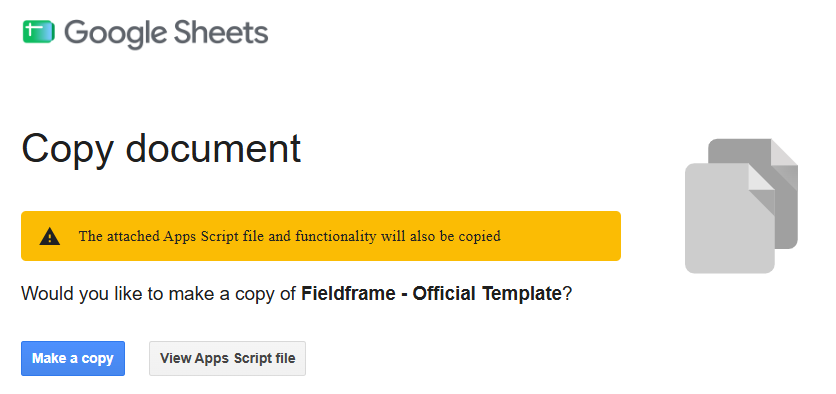
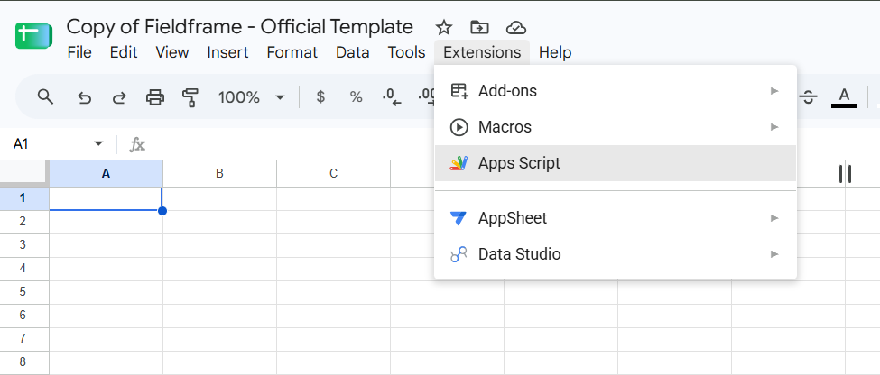
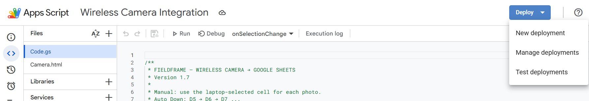
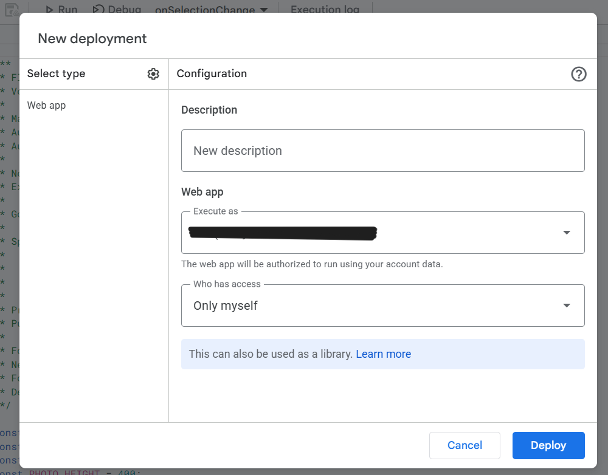
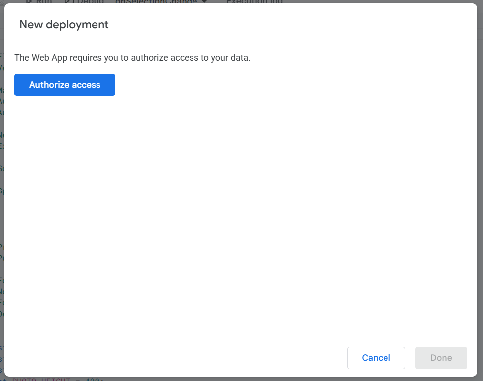
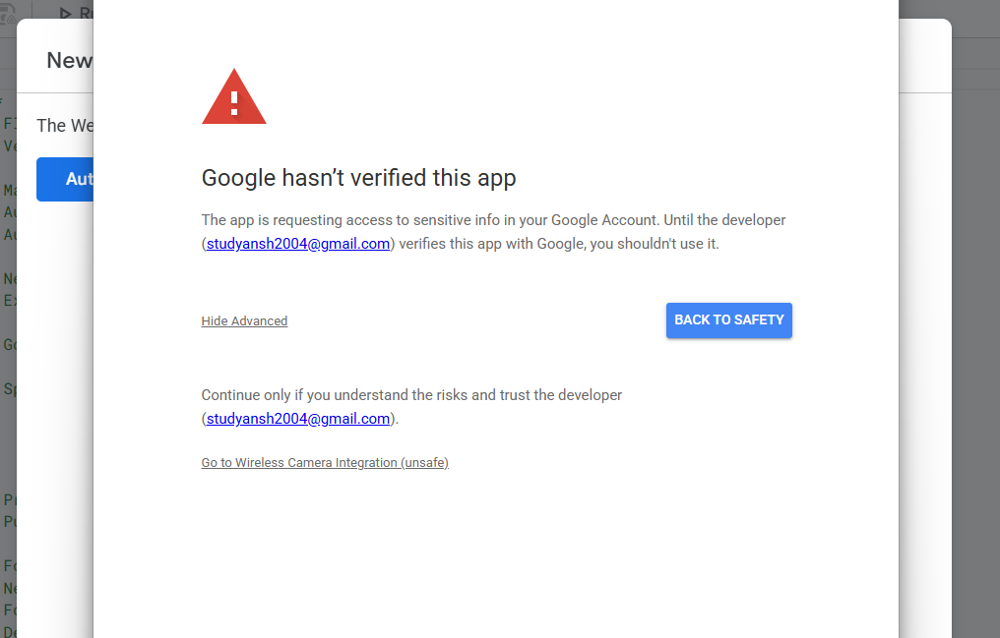
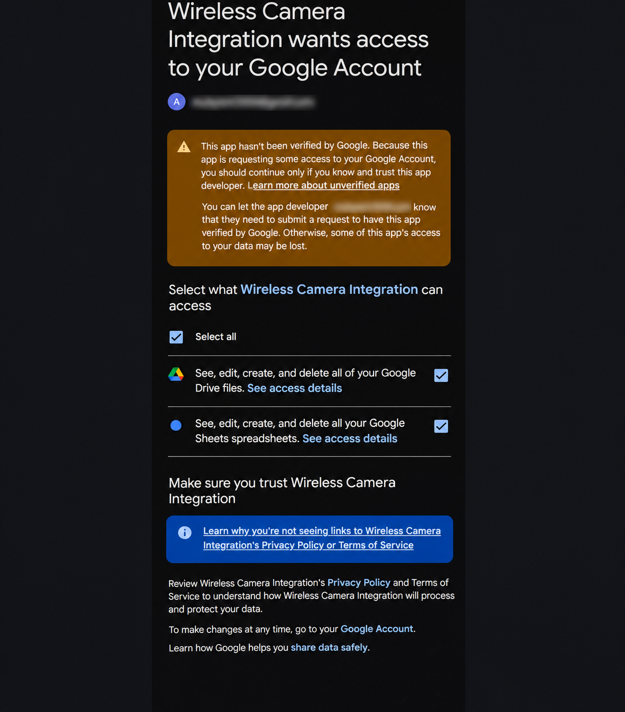
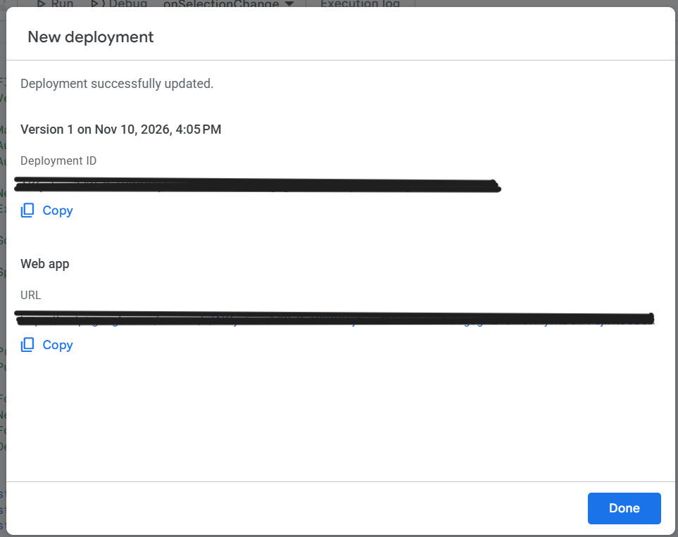
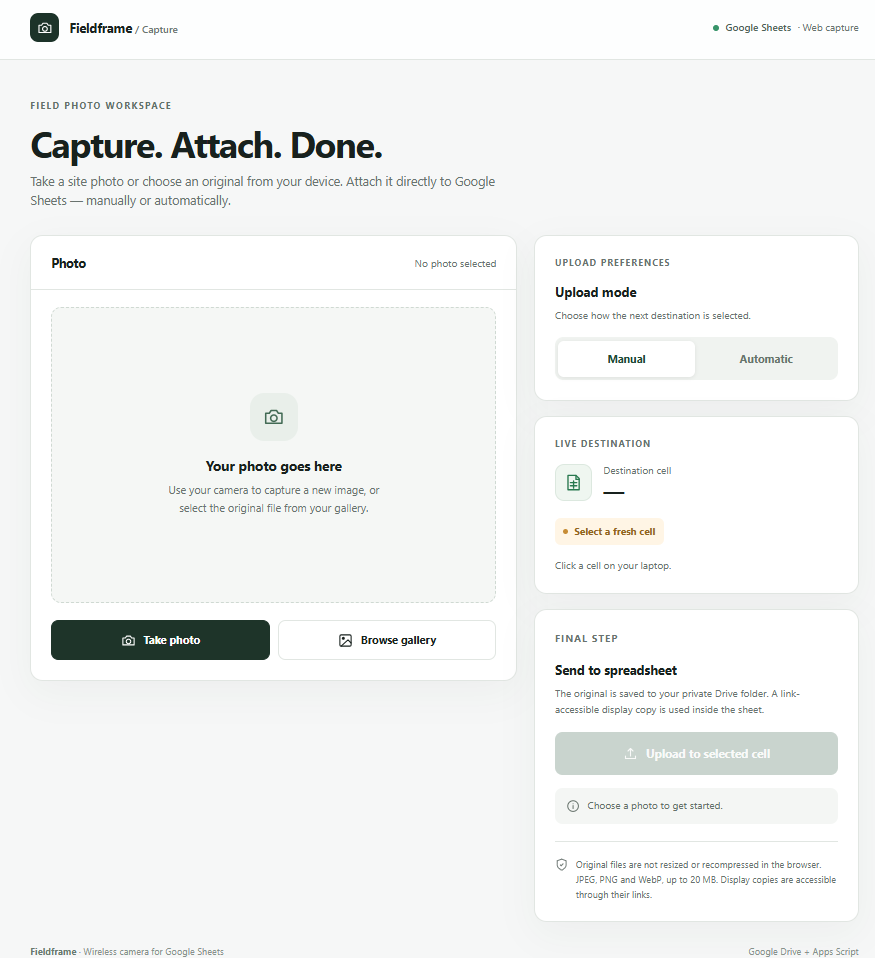

# Fieldframe

**Wireless mobile photography for Google Sheets.**

Fieldframe is an open-source application built with Google Apps Script that enables users to capture photographs on a smartphone and insert them directly into selected Google Sheets cells.

Designed for site inspections, construction documentation, field surveys, property assessments, and other workflows requiring photographic records alongside structured spreadsheet data.

Fieldframe operates using Google Sheets, Google Drive, and Google Apps Script, without requiring external servers or third-party hosting.

## Features

| Feature | Description |
|---|---|
| Wireless photography | Capture and upload photographs directly from a smartphone browser. |
| Automatic cell detection | Detect the currently selected cell in Google Sheets. |
| Manual mode | Insert photographs into manually selected cells. |
| Auto Down | Automatically advance to the next available cell below. |
| Auto Right | Automatically advance to the next available cell to the right. |
| Occupied-cell protection | Prevent existing spreadsheet content from being overwritten. |
| Original-quality storage | Preserve original uploaded photographs in Google Drive. |
| In-cell image insertion | Display photographs directly inside spreadsheet cells. |
| Multiple worksheet support | Work across worksheet tabs without additional deployments. |
| Automatic folder management | Organize images according to spreadsheet and worksheet names. |
| Folder recovery | Recreate missing or trashed storage folders when required. |

## Installation

Follow the instructions below to set up Fieldframe. No programming knowledge is required.

### Step 1 — Create Your Fieldframe Spreadsheet

Open the official template using the link below:

**[Create Your Fieldframe Spreadsheet](https://docs.google.com/spreadsheets/d/1bvV0MiGuvt216H870_CBKpRIjtGjZq5Z694eKtbWcMQ/copy)**

Sign in with your Google account if prompted.

You will be redirected to Google's **Copy document** screen.



Click **Make a copy** to create your personal Fieldframe spreadsheet.

The copied spreadsheet automatically includes the required Google Apps Script files (`Code.gs` and `Camera.html`). No manual code installation is necessary.

You may rename your spreadsheet according to your project requirements.

### Step 2 — Open Google Apps Script

Once your spreadsheet has been created, click **Extensions** in the Google Sheets menu.



Select **Apps Script** from the dropdown menu.

The Google Apps Script editor will open in a new browser tab.

The copied spreadsheet already includes the Fieldframe source files (`Code.gs` and `Camera.html`). No additional code installation is required.

### Step 3 — Create a New Deployment

In the Google Apps Script editor, locate the **Deploy** button in the upper-right corner.

Click **Deploy** and select **New deployment** from the dropdown menu.



This opens the deployment configuration window, where Fieldframe will be configured as a web application.

### Step 4 — Configure the Web Application

In the **New deployment** window:

1. Under **Select type**, click the **Settings (gear icon)**.
2. Select **Web app** from the available deployment types.
3. The web application configuration settings will appear.
4. Configure the following options:

| Setting | Value |
|---|---|
| Description | Fieldframe v1.7 |
| Execute as | Me |
| Who has access | Only myself |



**Configuration details:**

- **Execute as — Me:** Fieldframe runs using your authorized Google account to access Google Sheets and Google Drive.
- **Who has access — Only myself:** Restricts the application to your Google account, which is recommended for personal use.

After verifying the configuration, click **Deploy**.

### Step 5 — Authorize Fieldframe

After clicking **Deploy**, Google Apps Script will request authorization to access the Google services required by Fieldframe.

The following authorization screen will appear:



Click **Authorize access** to continue.

A Google sign-in window will open. Select the Google account you want to use with Fieldframe.

Review the requested permissions carefully before granting access.

Fieldframe requires access to Google Sheets and Google Drive to insert photographs into spreadsheet cells and organize uploaded images.

Google may display an unverified application warning because the Apps Script project is deployed independently by each user.

Proceed only after reviewing and trusting the application source code and requested permissions.

### Step 6 — Review the Google Verification Warning

During the first deployment, Google may display a **"Google hasn't verified this app"** warning.

This can occur because Fieldframe is deployed as an independent Google Apps Script project.



If this warning appears:

1. Click **Advanced**.
2. Confirm that you recognize and trust the copied Apps Script project.
3. Review the risks described by Google.
4. If you choose to proceed, click **Go to Wireless Camera Integration (unsafe)**. The application name may differ if you renamed the script project.

Only continue if you have reviewed the application's source code and trust the requested access. Otherwise, select **Back to Safety**.

Google will then display the permissions requested by the application.

### Step 7 — Review Google Account Permissions

Google will display the permissions requested by Fieldframe.



Fieldframe requires access to Google Drive and Google Sheets to store photographs, manage folders, and insert images into spreadsheet cells.

Follow these steps:

1. Review the permissions requested for **Google Drive** and **Google Sheets**.
2. Click the **Select all** checkbox to select both permissions.
3. Scroll down to the bottom of the authorization window.
4. Click the **Continue** button to grant the selected permissions.

**Note:** These permissions provide broad access to your Google Drive files and spreadsheets. Proceed only if you have reviewed the application's source code, understand the requested access, and trust the application.

Once authorization is complete, Google Apps Script will continue the deployment process.

### Step 8 — Copy Your Fieldframe Web App URL

After completing Google authorization, Apps Script will finish deploying Fieldframe.

A confirmation window will appear indicating that the deployment was successful.



Follow these steps:

1. Locate the **Web app** section in the deployment confirmation window.
2. Under **URL**, click the **Copy** button.
3. Save this URL somewhere accessible, or send it to your smartphone.
4. Click **Done** to close the deployment window.

**Important:** Copy the URL under **Web app**, not the **Deployment ID**.

The Web app URL is your personal Fieldframe camera interface. You can open it on your smartphone whenever you need to capture photographs.

Since the application was deployed with **Who has access: Only myself**, you must sign in using the Google account that deployed Fieldframe.

### Step 9 — Open the Fieldframe Camera Interface

After copying your Web app URL, open it in a browser on your smartphone.

If prompted, sign in using the same Google account that deployed Fieldframe.

The Fieldframe interface will appear as shown below:



The interface contains four main sections:

1. **Photo:** Capture a new photograph using your device camera or choose an existing image from your gallery.
2. **Upload Mode:** Choose between Manual and Automatic modes.
3. **Live Destination:** Displays the currently selected Google Sheets cell.
4. **Send to Spreadsheet:** Uploads the selected photograph into the destination cell.

Keep the Fieldframe web application open on your smartphone and the corresponding Google Sheet open on your computer.

You are now ready to capture your first photograph.


### Step 10 — Watch the Demonstration

Watch the complete Fieldframe demonstration to see how
your smartphone connects with Google Sheets, detects the
selected cell, and uploads photographs directly into
your spreadsheet.

[](https://youtu.be/cqA6P_2qDD8)

**[Watch the Full Demonstration on YouTube](https://youtu.be/cqA6P_2qDD8)**


#### Uploading a Photograph

1. Open your Fieldframe spreadsheet on your computer.
2. Select an empty destination cell in Google Sheets.
3. Keep the Fieldframe web application open on your smartphone.
4. Wait for the selected cell to appear in the **Live Destination** section.
5. Click **Take photo** to capture a new photograph, or **Browse gallery** to select an existing image.
6. Review the selected photograph and confirm the destination cell.
7. Click **Upload to selected cell**.
8. Wait for the upload to complete and verify that the photograph appears inside the selected spreadsheet cell.

#### Upload Modes

Fieldframe supports three upload behaviors:

| Mode | Behavior |
|---|---|
| Manual | Uses the destination cell selected in Google Sheets for each photograph. |
| Auto Down | Automatically advances to the next available cell below the previous destination. |
| Auto Right | Automatically advances to the next available cell to the right. |

In Automatic mode, Fieldframe skips occupied cells to avoid overwriting existing spreadsheet content.

You can select another cell in Google Sheets to change the destination at any time.

For additional photographs, repeat the capture and upload process.

---

## Important Usage Guidelines

### Allow Time for Initialization

When opening or reopening your Fieldframe spreadsheet and deployed web application, allow some time for the cell-selection tracking and web interface to initialize.

For the most reliable experience:

1. Open your Fieldframe spreadsheet on your computer.
2. Allow approximately **1–2 minutes**, particularly when opening the spreadsheet or web application after a period of inactivity.
3. Open or refresh the Fieldframe web application on your smartphone.
4. Select an empty cell in Google Sheets.
5. Wait for the correct destination cell to appear in the Fieldframe interface before uploading.

The 1–2 minute wait is a recommended precaution, not a fixed technical requirement. Fieldframe may become ready much sooner.

If the selected cell is not detected, refresh Google Sheets, select the cell again, and allow the interface to update.

### Avoid Rapid Cell Switching

Fieldframe tracks the currently selected spreadsheet cell and communicates that information to the mobile web application.

Avoid switching rapidly between cells or worksheet tabs while preparing to upload a photograph.

For reliable operation:

1. Select the intended destination cell in Google Sheets.
2. Wait a few seconds for Fieldframe to detect the selection.
3. Verify that the **Live Destination** section displays the correct cell.
4. Upload the photograph only after confirming the destination.

If you select another cell, wait for the new destination to appear before continuing.

**Important:** Always verify the destination cell before uploading. Rapid selection changes may cause Fieldframe to display an earlier selection temporarily.

### Keep Both Applications Accessible

Fieldframe is designed to work with Google Sheets and the mobile camera interface together.

For the recommended workflow:

- Keep Google Sheets open on your computer.
- Keep Fieldframe open on your smartphone.
- Maintain an active internet connection on both devices.
- Confirm the destination before uploading photographs.

If the web application is refreshed or reopened, allow it to reconnect and display the latest destination before continuing.

---

## Google Drive Folder Organization

Fieldframe automatically creates and manages Google Drive folders for uploaded photographs.

Folders are organized according to the names of your spreadsheet and its individual worksheets.

### Understanding Spreadsheets and Worksheets

A **spreadsheet** is the complete Google Sheets file.

A **worksheet**, also called a **sheet tab**, is an individual tab inside that spreadsheet.

A single spreadsheet can contain multiple worksheets.

For example, you might create a spreadsheet named:

`Construction Site Inspection`

Inside it, you can create separate worksheet tabs for:

- Building A
- Building B
- Building C

Fieldframe supports these worksheets within the same deployment.

### Automatic Folder Creation

When you upload the first photograph to a worksheet, Fieldframe automatically creates the corresponding folders in Google Drive.

For the example above, the resulting folder structure is:

```text
My Drive/
└── Construction Site Inspection/
    ├── Building A/
    │   ├── Building A-private/
    │   └── Building A-public/
    │
    ├── Building B/
    │   ├── Building B-private/
    │   └── Building B-public/
    │
    └── Building C/
        ├── Building C-private/
        └── Building C-public/
```

Each worksheet receives two dedicated image-storage folders.

#### Private Folder

The `-private` folder stores the original uploaded photographs.

These files preserve the original uploaded image bytes without browser-side resizing or recompression.

Original photographs remain private by default, subject to the permissions of the Google Drive account and any subsequent sharing changes.

#### Public Folder

The `-public` folder stores display copies of photographs used for rendering images inside Google Sheets cells.

These display files are configured with link-based viewing permissions.

Anyone possessing a valid link to an individual display file may be able to access that photograph.

The `-public` folder name describes its purpose; it does not mean that the entire folder is automatically shared publicly.

### When Are Folders Created?

Folders are created when the first photograph is uploaded to the corresponding worksheet.

For example:

1. Create a worksheet named `Building A`.
2. Select an empty cell and upload a photograph.
3. Fieldframe creates the `Building A` folder and its `Building A-private` and `Building A-public` subfolders.
4. Create another worksheet named `Building B`.
5. Upload a photograph to `Building B`.
6. Fieldframe creates a separate folder structure for that worksheet.

You do not need to create these folders manually.

### Creating Multiple Worksheets

You can create multiple worksheets within the same Google Sheets spreadsheet.

To create another worksheet:

1. Open your Fieldframe spreadsheet.
2. Click the **+ (Add sheet)** button near the worksheet tabs at the bottom.
3. Rename the new worksheet according to your project or location.
4. Select an empty cell in the new worksheet.
5. Wait for Fieldframe to detect the new worksheet and destination.
6. Capture and upload your photograph.

Fieldframe automatically creates the corresponding Drive folders when the first photograph is uploaded.

**No additional deployment is required for new worksheets within the same spreadsheet.**

### Spreadsheet and Worksheet Naming

Fieldframe uses the names you assign in Google Sheets to organize Google Drive folders.

| Google Sheets Name | Corresponding Google Drive Folder |
|---|---|
| Spreadsheet: `Site Inspection` | `Site Inspection/` |
| Worksheet: `Floor 1` | `Site Inspection/Floor 1/` |
| Worksheet: `Floor 2` | `Site Inspection/Floor 2/` |
| Worksheet: `Roof Inspection` | `Site Inspection/Roof Inspection/` |

For each worksheet, Fieldframe also creates two subfolders ending in `-private` and `-public`.

If you rename your spreadsheet or worksheet, Fieldframe updates the corresponding tracked folder names during a subsequent upload.

### Folder Recovery

Fieldframe tracks its Google Drive storage folders.

If a tracked folder becomes unavailable or is moved to Trash, Fieldframe can create a replacement during a subsequent upload.

This does not restore photographs that were deleted with the original folder.

### Using a Completely New Spreadsheet

Additional worksheets within an existing spreadsheet work with the same deployment.

However, a completely separate Google Sheets spreadsheet requires:

1. Creating another copy of the Fieldframe template.
2. Opening Apps Script from that new spreadsheet.
3. Deploying a new web application.
4. Using the new deployment URL for that spreadsheet.

Each copied spreadsheet maintains its own Fieldframe configuration and Drive folder references.

---

## Architecture

Fieldframe is implemented as a spreadsheet-bound Google Apps Script application.

| Component | Responsibility |
|---|---|
| Google Sheets | Spreadsheet interface, worksheet management, and cell selection |
| Google Apps Script | Selection tracking, upload processing, image insertion, and Drive management |
| HTML Service | Web-based mobile camera interface |
| Google Drive | Original photograph and display-image storage |
| Script Properties | Selection state and Drive folder references |

The primary source files are:

```text
fieldframe/
├── Code.gs
├── Camera.html
├── README.md
├── LICENSE
└── docs/
    ├── images/
    └── videos/
        └── fieldframe-demo.mp4
```

`Code.gs` contains the server-side logic responsible for spreadsheet integration, cell tracking, upload validation, and Google Drive operations.

`Camera.html` contains the web interface for capturing or selecting photographs and communicating with the Apps Script backend.

---

## Security and Privacy

Fieldframe runs using the Google account that authorizes and deploys the web application.

The application requires access to Google Sheets and Google Drive to perform its core functions.

### Google Account Permissions

Google may request broad permissions to view, edit, create, and delete files in Google Drive and spreadsheets in Google Sheets.

Users should review these permissions carefully before authorizing the application.

Fieldframe does not require users to enter their Google account passwords or create separate API credentials.

### Photograph Storage

Fieldframe maintains two categories of image files:

- **Original photographs:** Stored in private Drive folders by default.
- **Display copies:** Stored separately and configured for link-based viewing to support in-cell image rendering.

Because display copies are accessible through their file links, Fieldframe should not be used for confidential or sensitive photographs unless this access model is acceptable for the intended workflow.

### Access to the Web Application

For personal use, the recommended deployment configuration is:

- **Execute as:** Me
- **Who has access:** Only myself

This restricts access to the deployed web application to the deploying Google account.

### Concurrent Usage

Fieldframe maintains the selected destination using script-level state.

The current implementation is primarily intended for a single active operator per deployed spreadsheet.

Independent simultaneous operation by multiple users is not guaranteed.

---

## Troubleshooting

| Issue | Recommended Action |
|---|---|
| Destination cell not detected | Refresh Google Sheets, select the destination cell again, and wait for Fieldframe to update. |
| Destination is outdated | Avoid rapid cell switching and wait for the correct selection to appear. |
| Fieldframe takes time to initialize | Allow approximately 1–2 minutes as a precaution, particularly after reopening the spreadsheet. |
| Selected cell has expired | Select an empty cell again and confirm the updated destination. |
| Cell is already occupied | Select an empty destination or use an automatic mode. |
| Camera permission denied | Enable camera access for your browser and reload Fieldframe. |
| Photograph not uploading | Check the internet connection, image format, size, and destination status. |
| Google authorization error | Verify that the correct Google account was used and review the granted permissions. |
| Web app URL not opening | Confirm the deployment access settings and use the correct Web app URL. |
| New worksheet not detected | Select a cell in the new worksheet and wait for Fieldframe to update. |
| Drive folders not visible | Upload the first photograph to the worksheet, then check Google Drive. |
| Folder name not updated | Upload another photograph after renaming the spreadsheet or worksheet. |
| New spreadsheet not connected | Create a new copy of the template and deploy that spreadsheet separately. |

---

## Technical Requirements

- A Google account with access to Google Sheets, Google Drive, and Apps Script.
- A desktop or laptop browser for spreadsheet interaction.
- A smartphone with a camera and modern web browser.
- An internet connection on both devices.
- Permission to authorize the required Google Workspace services.

## Limitations

- Each independently copied spreadsheet requires its own web app deployment.
- Fieldframe is designed primarily for a single active operator per deployment.
- Cell selection updates may not be instantaneous.
- Rapid cell or worksheet switching may temporarily produce outdated destination information.
- Uploads are subject to Google Apps Script execution limits and Google Drive storage quotas.
- Supported image formats are JPEG, PNG, and WebP, with an upload limit of up to 20 MB per photograph.
- Display-image files use link-based viewing permissions.
- Permanently deleted photographs cannot be restored automatically by Fieldframe.
- The application requires an active internet connection and appropriate Google account permissions.

---

## License

Fieldframe is released under the MIT License. See [LICENSE](LICENSE) for details.
